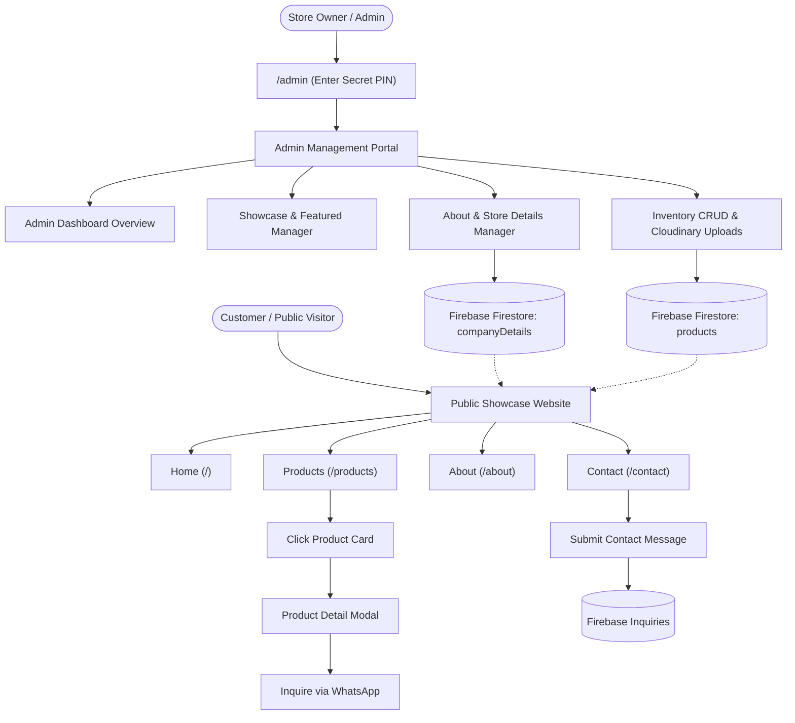

# Sri Senthoora Fancy Store (ஸ்ரீ செந்தூரா ஃபேன்சி ஸ்டோர்)

A modern, responsive, high-performance product showcase web application for **Sri Senthoora Fancy Store**, built using **React 19**, **Tailwind CSS v4**, **Node.js Express**, **Firebase Firestore**, and **Cloudinary**.

> **Crucial Architecture Notice:** This is strictly a **product showcase website**, designed to showcase exquisite bridal bangles, matte gold imitation jewelry, trending cosmetics, clutches, and celebratory gifts for customer inquiry and in-store showroom visits. It contains **no cart, no checkout, and no online payment gateway flows**. Display rates are for customer reference only.

---

## 🧭 Complete Application Flow



---

### 1. 🛍️ Public Showcase Flow (Customer Experience)

1. **Header & Navigation ([Navbar.jsx](file:///e:/Projects/senthoora_fancy/src/components/common/Navbar.jsx)):**
   - Clean, sticky boutique navigation with accessible skip-to-content links.
   - Live Store Timings indicator badge (*"Open Today: 09:30 AM – 09:30 PM"*).
   - Global **Light/Dark theme toggle** switch.
   - Quick WhatsApp contact button.
   - **Privacy Boundary:** The *Inventory* tab is strictly hidden and never accessible in public menus.

2. **Home Page ([Home.jsx](file:///e:/Projects/senthoora_fancy/src/pages/Home.jsx)):**
   - **Hero Section:** Elegant typography with boutique branding, Tamil trade title (*ஸ்ரீ செந்தூரா பேன்சி ஸ்டோர்*), and direct visit callouts.
   - **Department Showcase:** Visual cards for *Bridal Bangles & Chuda*, *Antique Jewelry*, *Cosmetics*, and *Celebration Gifts* with distinct Lucide category icons and live inventory counts.
   - **Featured Showcase:** Hand-picked products dynamically highlighted by the administrator.
   - **Showroom Values & Highlights:** Authentic 1-gram gold finishes, velvet chudas, saree color matching, and trusted local service.

3. **Products Catalog ([Products.jsx](file:///e:/Projects/senthoora_fancy/src/pages/Products.jsx)):**
   - **Category Filters:** Filter instantly by categories (*All, Bangles, Jewelry, Cosmetics, Hair Accessories, Handbags, Gifts, Perfumes*).
   - **Rate Range Presets:** Filter by showcase rate chips (*All Rates, Under ₹500, ₹500 - ₹1,000, ₹1,000 - ₹2,000, Above ₹2,000*).
   - **Real-Time Search:** Instant client-side search by item name, badge, and description.
   - **Active Filter Badges:** Visible tags showing active query and rate filters with a 1-click *Clear Filters* action and `aria-live` accessible results summary.
   - **Resilient Media Display:** Every product card utilizes `ImageWithFallback` with skeleton loading animations and error fallbacks.

4. **Product Detail & Inquiry Modal ([ProductModal.jsx](file:///e:/Projects/senthoora_fancy/src/components/common/ProductModal.jsx)):**
   - Clicking any product opens an accessible dialog with `role="dialog"`, `aria-modal="true"`, and keyboard `Escape` closing.
   - Displays full-resolution photo, showcase rate, category badge, stock status (*In Showroom*), and material descriptions.
   - **One-Click WhatsApp Inquiry:** Pre-fills a custom message (*"Hello Sri Senthoora Fancy Store, I am inquiring about [Product Name] showcased at [Rate]..."*) directly opening WhatsApp with the store owner.

5. **About Page ([About.jsx](file:///e:/Projects/senthoora_fancy/src/pages/About.jsx)):**
   - Store founding story, core values, bridal customization studio overview, and physical showroom credentials.
   - All details (store name, established year, address, business hours) are loaded dynamically from Firebase.

6. **Contact Page ([Contact.jsx](file:///e:/Projects/senthoora_fancy/src/pages/Contact.jsx)):**
   - Verified physical address, phone numbers, and WhatsApp numbers.
   - Live interactive Google Maps embed.
   - **Customer Inquiry Form:** Rate-limited and sanitized form allowing visitors to send their name, phone, email, and inquiry directly to the store database.

7. **Footer ([Footer.jsx](file:///e:/Projects/senthoora_fancy/src/components/common/Footer.jsx)):**
   - Reusable company details, trust badges, quick navigation links, store hours, showcase disclaimer, and developer credits.

---

### 2. 🔐 Admin Management Flow (Store Owner Portal)

Access route: `http://localhost:5173/admin`

1. **PIN Authentication Modal ([AdminPinModal.jsx](file:///e:/Projects/senthoora_fancy/src/admin/components/AdminPinModal.jsx)):**
   - Secured by `ADMIN_PIN` configured in your server `.env` file.
   - Protected against brute-force attacks via server-side rate limiting (10 attempts / 15 minutes).
   - On successful verification, the server issues a cryptographically secure, unguessable 256-bit session token with an 8-hour TTL.
   - Includes full keyboard support, on-screen quick keypad with accessible touch targets, and automatic focus trapping.

2. **Admin Navigation Menu ([AdminLayout.jsx](file:///e:/Projects/senthoora_fancy/src/admin/layout/AdminLayout.jsx)):**
   - Strictly 4 streamlined management modules:
     1. **Home** (`/admin`): Metrics and quick shortcuts.
     2. **Products** (`/admin/products`): Showcase catalog review & featured toggles.
     3. **About & Store Details** (`/admin/about`): Centralized store configuration & customer inbox.
     4. **Inventory** (`/admin/inventory`): Product CRUD & Cloudinary photo uploads.

3. **Admin Dashboard ([AdminHome.jsx](file:///e:/Projects/senthoora_fancy/src/admin/pages/AdminHome.jsx)):**
   - Live metrics: Total Showcase Items, Featured on Home, Active Categories, and Customer Inquiries count.
   - Recent inventory items quick-preview.

4. **Showcase Products Manager ([AdminProducts.jsx](file:///e:/Projects/senthoora_fancy/src/admin/pages/AdminProducts.jsx)):**
   - Responsive dual layout: Wide screen table and mobile cards (< 640px).
   - One-click **Featured on Home** toggle: Immediately updates whether a product appears on the public homepage hero section.

5. **About & Store Details Manager ([AdminAbout.jsx](file:///e:/Projects/senthoora_fancy/src/admin/pages/AdminAbout.jsx)):**
   - **Tab 1: Store Identity & Branding:** English name, Tamil name, Tagline, Established Year, and Store Logo.
   - **Tab 2: Story & Disclaimer:** Showroom story description and public showcase notice banner.
   - **Tab 3: Contact Details:** Primary phone, secondary phone, WhatsApp number, inquiry pre-fill text, and store emails.
   - **Tab 4: Address & Location:** Street door number, landmark, city, state, pincode, and Google Maps embed URL.
   - **Tab 5: Timings & Socials:** Monday–Saturday hours, Sunday hours, festive timings, and social links.
   - **Tab 6: Customer Inquiries Inbox:** Displays customer inquiries received with timestamps, product names, customer phone numbers, and direct **"Reply on WhatsApp"** action links.

6. **Inventory Management & Cloudinary Storage ([AdminInventory.jsx](file:///e:/Projects/senthoora_fancy/src/admin/pages/AdminInventory.jsx)):**
   - **Add & Edit Modal:** Accessible modal with dual photo mode (Cloudinary upload or direct image URL).
   - **Automatic Canvas Compression:** Large camera photos (5MB+) are compressed down to 1200px max dimension on an HTML5 canvas before upload, keeping transfers under 250KB and saving Cloudinary storage.
   - **Product Schema:** Product Name, Photo URL, Cloudinary Public ID, Display Rate, Category, Description, Badge (e.g. *Bridal Special*), Featured Checkbox, and Tags. All text inputs are sanitized server-side.
   - **Cloudinary Cleanup:** Deleting an inventory item or replacing its photo automatically purges the old asset from Cloudinary storage.

---

## 🛠️ Technology Stack Summary

| Layer | Technologies Used |
| :--- | :--- |
| **Frontend Core** | React 19, Vite 6, React Router DOM v7, Context API, Code Splitting (`React.lazy`) |
| **Styling** | Tailwind CSS v4 (`@tailwindcss/vite`), Custom `@custom-variant dark` |
| **Icons & UI** | Lucide React, Custom SVG Brand Emblems |
| **Backend Server** | Node.js, Express 4, CORS, Dotenv, Multer, Express Rate Limit |
| **Security** | Cryptographic random session tokens (256-bit entropy), Rate-limited PIN verification, Input sanitization |
| **Database** | Firebase Admin SDK 13 (Firestore) + Resilient Serialized JSON Fallback |
| **Media Hosting** | Cloudinary v2 (with client-side HTML5 canvas compression) |

---

## ⚙️ Environment Variables

Copy `.env.example` to `.env` and fill in the values:

```bash
cp .env.example .env
```

| Variable | Required | Description |
| :--- | :---: | :--- |
| `PORT` | Optional | Server port (Default: `3001`) |
| `ADMIN_PIN` | **Required** | Secret PIN for store administrator access (Default for dev: `1234`, change before production!) |
| `FIREBASE_PROJECT_ID` | Optional* | Firebase project ID (or provide via `credentials.json`) |
| `FIREBASE_CLIENT_EMAIL` | Optional* | Service account client email |
| `FIREBASE_PRIVATE_KEY` | Optional* | Service account private key string |
| `CLOUDINARY_CLOUD_NAME` | Optional** | Cloudinary cloud name for media uploads |
| `CLOUDINARY_API_KEY` | Optional** | Cloudinary API key |
| `CLOUDINARY_API_SECRET` | Optional** | Cloudinary API secret |
| `CLOUDINARY_FOLDER` | Optional | Target Cloudinary folder (Default: `senthoora_fancy_showcase`) |
| `FRONTEND_URL` | Recommended | Production frontend domain for CORS allow-listing (e.g. `https://your-domain.vercel.app`) |

*\*Note on Firebase Credentials:* If using a service account JSON file, name it `credentials.json` in the project root. **Never commit `credentials.json` to git** (it is in `.gitignore`).
*\*\*Note on Local Storage:* If Firebase is not connected, the server automatically saves data to `server/data/store.json`. This file is ignored by `.gitignore` and must not be committed.

---

## 🚀 Getting Started

### 1. Install Dependencies
```bash
npm install
```

### 2. Configure Environment
Create `.env` using `.env.example` and set your secret `ADMIN_PIN`.

### 3. Run Development Environment
Starts both Express backend (`3001`) and Vite client (`5173`) concurrently:
```bash
npm run dev
```

To expose over your local WiFi network for mobile testing:
```bash
npm run dev -- --host
```

### 4. Build for Production
```bash
npm run build
npm start
```

---

## 👨‍💻 Developer & Attribution
- **Client:** Sri Senthoora Fancy Store (ஸ்ரீ செந்தூரா ஃபேன்சி ஸ்டோர்)
- **Crafted by:** [Murali](https://myself-murali.vercel.app/)
